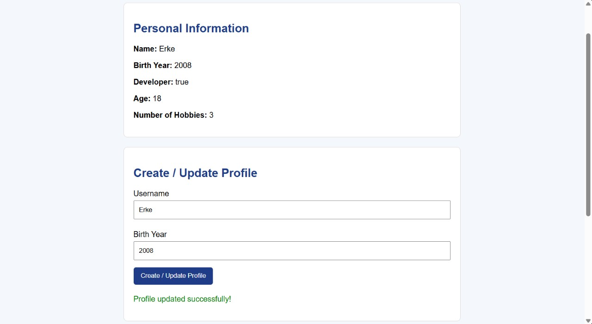

# Assignment 5 — JavaScript Basics

**Name:** Yerkezhan Vassenzhan  
**Group:** IT-2504

## Task 1 — Personal Information Object
Created a userProfile object with a name, birth year, developer status, and hobbies array.

## Task 2 — Arithmetic Calculations
Calculated the user's age dynamically and displayed the number of hobbies.

Screenshot: 

## Task 3 — HTML Form
Created Username and Birth Year inputs.

Screenshot: 

## Task 4 — Event Listener
Added a submit event listener to update the userProfile object.

Screenshot: 

## Task 5 — DOM List Manipulation
Added buttons to add a new hobby and remove the last hobby from the list.

Screenshot: 

## Summary
In this assignment, I practiced JavaScript objects, variables, arithmetic operators, event listeners, and DOM manipulation.
